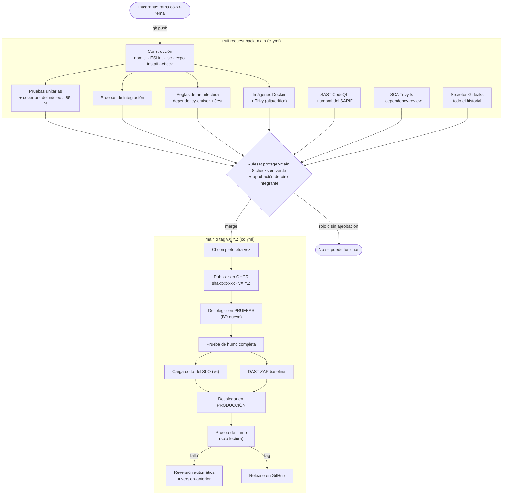

# DevOps: pipeline, etapas, umbrales y reversión

**Diseño y Arquitectura de Software (DYAS) · Corte 3**

Qué le pasa a un cambio desde el commit hasta producción, qué verifica cada etapa, qué umbral la detiene y por qué se eligió ese valor. Las decisiones de fondo están en el [ADR-008](adr/ADR-008-estrategia-de-despliegue.md) (dónde y cómo se despliega) y el [ADR-009](adr/ADR-009-seguridad-del-pipeline.md) (controles de seguridad). La vista de despliegue está en [arquitectura.md §8](arquitectura.md#8-vista-de-despliegue-corte-3).

---

## 1. El camino de un cambio



1. **Trabajo por ramas (GitHub Flow).** Cada tarea tiene su rama (`c3-<id>-<tema>`) y su pull request. Nadie hace push a `main`: el ruleset `proteger-main` lo impide, también para el administrador.
2. **En cada push a una rama y en cada PR** corre `ci.yml`: ocho jobs, uno por etapa, que aparecen como ocho checks en el PR.
3. **Para fusionar** el ruleset exige: PR, los 8 checks en verde, CodeQL sin alertas altas o críticas, y la aprobación de **otro** integrante. La aprobación se descarta si llega un push nuevo, y el último push debe aprobarlo alguien distinto de quien lo hizo.
4. **Al fusionar a `main`** corre `cd.yml`: repite el CI (lo que se publica es lo que pasó las verificaciones en ese commit), publica las imágenes, despliega en pruebas, verifica, despliega en producción y verifica otra vez.
5. **Al crear un tag `vX.Y.Z`** corre el mismo `cd.yml`: las imágenes quedan etiquetadas con la versión, se despliega esa versión y el job **Release en GitHub** crea la Release con las notas de los PR incluidos.

**Historial anterior al Corte 3.** Los commits de septiembre (`e48bf46`, `cfb3ff9`) se hicieron directamente en `main` durante el Corte 2, cuando el proyecto no tenía pipeline. Desde el primer PR del Corte 3 (2026-11-05) y el ruleset (2026-11-06), todo entró por pull request aprobado por otro integrante: [#1](https://github.com/ItsN3M3515/soporte-tecnico-corte3/pull/1), [#2](https://github.com/ItsN3M3515/soporte-tecnico-corte3/pull/2), [#3](https://github.com/ItsN3M3515/soporte-tecnico-corte3/pull/3), [#20](https://github.com/ItsN3M3515/soporte-tecnico-corte3/pull/20), [#23](https://github.com/ItsN3M3515/soporte-tecnico-corte3/pull/23), [#26](https://github.com/ItsN3M3515/soporte-tecnico-corte3/pull/26), [#27](https://github.com/ItsN3M3515/soporte-tecnico-corte3/pull/27).

## 2. Etapas, umbrales y por qué

### 2.1 Integración continua (`ci.yml`)

| Etapa (check) | Qué verifica | Detiene el pipeline cuando… | Por qué ese umbral | Reporte (artefacto) |
|---|---|---|---|---|
| **Construcción** | `npm ci` en backend y app (dependencias exactas del `package-lock.json`), ESLint del backend con reglas de seguridad, que el servidor cargue todos sus módulos, `tsc --noEmit` de la app y `npx expo install --check` | Falla la instalación, hay un error de ESLint, un módulo no carga, hay un error de tipos o una dependencia de la app no es compatible con Expo SDK 57 | `expo install --check` se agregó cuando Dependabot propuso versiones de React incompatibles con el SDK (PR #21): la web compilaba, pero la app del celular habría fallado | Registro del job |
| **Pruebas unitarias y cobertura del dominio** | 227 pruebas de Jest del dominio y los casos de uso, sin base de datos ni red | Falla una prueba, o la cobertura de `src/domain` + `src/application` baja de **85 % de líneas** o **75 % de ramas** | El enunciado pide ≥ 70 %. Se configuró en 85 % porque el núcleo ya estaba en 98,6 % y el umbral debe atrapar una caída real sin fallar por una línea nueva. Está en `backend/package.json` (`jest.coverageThreshold`): Jest falla solo, no es un reporte | `reporte-pruebas-unitarias` (HTML de Jest + cobertura) |
| **Pruebas de integración** | 79 pruebas en las fronteras del hexágono con infraestructura real: HTTP con Supertest → casos de uso → SQLite en archivo, Socket.IO con clientes reales, lectura de los PNG de los QR impresos, consola de usuarios | Falla una prueba | Cualquier fallo es un defecto en una frontera | `reporte-pruebas-integracion` |
| **Reglas de arquitectura** | 7 reglas de dependencias del ADR-001 con dependency-cruiser (`backend/.dependency-cruiser.cjs`) y la prueba de Jest `tests/unit/arquitectura.test.js` | Una sola dependencia prohibida (por ejemplo, un archivo de `src/domain` que importa `src/adapters` o `express`) | Una regla de arquitectura no admite "pocas violaciones": una sola rompe la frontera | `reporte-arquitectura` |
| **SAST (CodeQL)** | Vulnerabilidades en el código propio (consultas `security-extended`) | Hallazgo alto o crítico (severidad ≥ 7,0) sin tratar | Umbral del enunciado con más consultas ([ADR-009](adr/ADR-009-seguridad-del-pipeline.md)) | `reporte-sast` (SARIF) |
| **SCA (dependencias con Trivy)** | CVE en los `package-lock.json` de backend, app y e2e; en los PR, además, dependencias nuevas vulnerables | Vulnerabilidad alta o crítica con corrección | Una sin corrección no se arregla actualizando; se registra como riesgo | `reporte-sca` |
| **Secretos (Gitleaks)** | Contraseñas, tokens y llaves en todos los commits | Un secreto | Cero, como pide el enunciado | `reporte-secretos` |
| **Imágenes Docker y escaneo (Trivy)** | Valida `docker-compose.yml` con `.env.example`, construye las dos imágenes y las escanea; genera el SBOM | Vulnerabilidad **alta** o crítica con corrección en el sistema operativo o las librerías de la imagen | Más estricto que el enunciado (solo crítica): corregir altas cuesta poco ([ADR-009](adr/ADR-009-seguridad-del-pipeline.md)) | `reporte-imagenes` (Trivy + SBOM CycloneDX) |

**Duración:** el CI completo tarda unos 4 minutos (primera ejecución: 4 min 18 s, [run 42135356449](https://github.com/ItsN3M3515/soporte-tecnico-corte3/actions/runs/42135356449)). El enunciado pide menos de 10. Lo logran:

- la caché de npm de `actions/setup-node` (clave: los `package-lock.json`);
- la caché de capas de Docker en GitHub Actions (`cache-from/cache-to: type=gha`), que `cd.yml` reutiliza para publicar sin reconstruir;
- jobs en paralelo: los tres de seguridad no esperan a Construcción;
- `concurrency`: un push nuevo a la misma rama cancela la ejecución anterior.

### 2.2 Despliegue y verificación (`cd.yml`)

| Etapa (job) | Dónde corre | Qué hace | Detiene el pipeline cuando… | Por qué |
|---|---|---|---|---|
| **CI** | GitHub | El mismo `ci.yml` (`workflow_call`) | Igual que arriba | Lo que se publica es exactamente el commit verificado |
| **Publicar imágenes en GHCR** | GitHub | `ghcr.io/itsn3m3515/asistec-backend` y `asistec-web` con `sha-<commit corto>` y, si es un tag, `vX.Y.Z`. `latest=false` | Falla la construcción o la publicación | Nunca se despliega `latest`: siempre se sabe qué commit corre en cada entorno |
| **Desplegar en pruebas** | Runner de la VM (`asistec`) | Escribe `/opt/asistec/pruebas/.env` desde GitHub Secrets, borra la base de pruebas y ejecuta `scripts/deploy.sh pruebas <etiqueta>` (`docker compose up --wait`) | Los contenedores no quedan sanos en 180 s | La base nueva hace que la carga mida siempre desde el mismo punto |
| **Prueba de humo (pruebas)** | GitHub, contra la URL pública | `scripts/smoke-test.sh <url> completo`: salud → la app carga → login → 401 sin token → escanear el QR → crear la solicitud → queda ASIGNADA → seguimiento | Un paso falla (espera hasta 120 s a que el healthcheck responda) | Es el flujo principal del sistema (reto "Reservar mediante QR") |
| **Prueba de carga del SLO (pruebas)** | Runner de la VM | `scripts/slo.sh <url> 30s`: espera el healthcheck, calienta la conexión y corre `perf/scripts/slo.js` (k6 2.3.0) | p95 crear solicitud > 500 ms, p95 consultar la cola > 300 ms o errores ≥ 1 % | Es el SLO del Corte 2, escrito como `thresholds` de k6. Corre desde la VM para no medir la red pública ([ADR-008](adr/ADR-008-estrategia-de-despliegue.md)) |
| **DAST (OWASP ZAP baseline)** | GitHub, contra la URL pública de pruebas | Escaneo pasivo con ZAP 2.17.0 y las reglas de `.zap/reglas.tsv` | Una regla `FAIL` | [seguridad.md §2](seguridad.md#2-controles-del-pipeline-quality-gates) |
| **Desplegar en producción** | Runner de la VM | Igual que pruebas, sin borrar datos, con Prometheus y Grafana | Los contenedores no quedan sanos | Solo llega aquí lo que pasó humo, SLO y ZAP en pruebas |
| **Prueba de humo (producción)** | GitHub | `smoke-test.sh <url> lectura`: igual, pero consulta "Mis solicitudes" en vez de crear una | Un paso falla | No se crean datos falsos en la cola real |
| **Reversión automática (producción)** | Runner de la VM | Solo si falló la prueba de humo de producción: `scripts/rollback.sh produccion` | — (el pipeline ya está en rojo) | Producción vuelve sola a la última versión buena |
| **Release en GitHub** | GitHub | Solo con un tag: `gh release create` con notas generadas de los PR | — | Versionado semántico visible en Releases |

**Duración típica del CD completo:** unos 6 minutos y medio, CI incluido ([run 42317748178](https://github.com/ItsN3M3515/soporte-tecnico-corte3/actions/runs/42317748178): CI 2 min 15 s, publicar 32 s, pruebas + humo 1 min, SLO y ZAP en paralelo 1 min 25 s, producción + humo 1 min).

**Si el entorno estaba apagado:** la prueba de humo y la de carga esperan hasta 2 minutos a que `GET /api/salud` responda antes de medir, como pide el enunciado. Si el servidor está apagado, los jobs del runner quedan en cola en GitHub hasta 24 horas y se ejecutan al encenderlo.

### 2.3 Otros workflows

| Workflow | Cuándo corre | Qué hace |
|---|---|---|
| `rollback.yml` (**Reversión**) | A mano | Vuelve a desplegar en `produccion` o `pruebas` una versión que ya está en GHCR y corre la prueba de humo |
| `slo-larga.yml` (**Prueba de carga larga**) | A mano | Escenario `pico` (o `baseline`) del Corte 2 contra pruebas, con los mismos umbrales del SLO. El enunciado permite manual o programada; se dejó manual porque una ejecución programada que falla por la red marcaría en rojo el último commit de `main` |
| `k8s.yml` (**Kubernetes**, bonificación) | Cuando cambian `k8s/`, los Dockerfile o nginx, y a mano | Crea un clúster kind, despliega los manifiestos, espera las probes, corre la prueba de humo y comprueba que la NetworkPolicy bloquea a un pod ajeno |

## 3. Entornos, secretos y versiones

| | Pruebas | Producción |
|---|---|---|
| URL | `https://asistec.tail15cf34.ts.net:8443` (variable `URL_PRUEBAS`) | `https://asistec.tail15cf34.ts.net` (variable `URL_PRODUCCION`) |
| Proyecto de Compose / puerto | `asistec-pruebas` / 8081 | `asistec-produccion` / 8080 |
| Base de datos | Nueva en cada despliegue | Persistente (volumen `datos-soporte`) |
| GitHub Environment | `pruebas` (secreto `JWT_SECRET`) | `produccion` (secretos `JWT_SECRET`, `GRAFANA_ADMIN_PASSWORD`) |
| Ramas permitidas | `main` y tags `v*.*.*` | `main` y tags `v*.*.*` |
| Observabilidad | No | Prometheus + Grafana (`https://asistec.tail15cf34.ts.net:3443`, solo en la red privada del equipo) |

Ningún secreto está en el repositorio ni en la imagen: el job de despliegue escribe el `.env` del entorno en el servidor (`scripts/escribir-env.sh`, permisos 0600). Para exigir una aprobación manual antes de producción basta agregar *Required reviewers* al environment `produccion`; no se activó para que la demostración muestre el camino completo sin esperas.

**Versionado semántico.** `vMAYOR.MENOR.PARCHE`: MAYOR si cambia la API de forma incompatible, MENOR para funcionalidad o documentación nueva compatible, PARCHE para correcciones. Las versiones están en [Releases](https://github.com/ItsN3M3515/soporte-tecnico-corte3/releases) y en [CHANGELOG.md](../CHANGELOG.md). Para publicar una: [implementacion.md §7.1](implementacion.md#71-publicar-una-versión-nueva).

## 4. Reversión

### 4.1 Cómo funciona

En cada entorno, `scripts/deploy.sh` guarda en el servidor (`/opt/asistec/<entorno>/`) la etiqueta desplegada (`version-actual`), la anterior (`version-anterior`) y una línea por despliegue o reversión en `historial.log`. Revertir es desplegar de nuevo una imagen que ya está en GHCR: no se reconstruye nada y tarda menos de un minuto.

### 4.2 Procedimiento

**Opción A, desde GitHub (recomendada):** pestaña **Actions** → **Reversión** → **Run workflow** → elegir el entorno y escribir la etiqueta (`v1.0.0` o `sha-1a2b3c4`); vacía, vuelve a `version-anterior`. Con la CLI:

```bash
gh workflow run rollback.yml -R ItsN3M3515/soporte-tecnico-corte3 -f entorno=produccion -f version=v1.0.0
```

El workflow despliega la versión y corre la prueba de humo. Las etiquetas disponibles están en *Packages* (`asistec-backend`) o en el historial del CD (job **Publicar imágenes en GHCR** → Resumen).

**Opción B, en el servidor** (si GitHub no está disponible):

```bash
cd ~/soporte-tecnico-corte3          # una copia del repositorio en el servidor
scripts/rollback.sh produccion v1.0.0   # o sin etiqueta: vuelve a version-anterior
```

**Automática:** si la prueba de humo de producción falla después de un despliegue, el job **Reversión automática (producción)** ejecuta `scripts/rollback.sh produccion` sin intervención.

**Después de revertir:** el commit que causó el problema sigue en `main`. Se corrige con un PR nuevo (o se revierte el PR con el botón *Revert* de GitHub, que también pasa por el pipeline); el siguiente despliegue verde deja todo alineado.

### 4.3 Evidencia: reversiones ejecutadas

| Fecha (UTC) | Tipo | Ejecución | Qué pasó |
|---|---|---|---|
| 2026-11-06 14:14 | Manual | [run 42232225681](https://github.com/ItsN3M3515/soporte-tecnico-corte3/actions/runs/42232225681) | Producción de `v1.0.0` a `sha-2e4d697`; prueba de humo OK |
| 2026-11-06 14:16 | Manual (vuelta) | [run 42232468575](https://github.com/ItsN3M3515/soporte-tecnico-corte3/actions/runs/42232468575) | De `sha-2e4d697` a `v1.0.0`; prueba de humo OK |
| 2026-11-06 16:03 | **Automática** | [run 42247596257](https://github.com/ItsN3M3515/soporte-tecnico-corte3/actions/runs/42247596257) (intento 1) | La prueba de humo de producción falló en el paso 5 por un error de TLS aislado del túnel (`SSL_ERROR_SYSCALL`); el job de reversión devolvió producción de `sha-0a620f2` a `sha-c2f0e5d`. Se volvió a ejecutar el run (intento 2, en verde a las 16:10) y se agregaron reintentos de conexión a la prueba de humo (PR [#27](https://github.com/ItsN3M3515/soporte-tecnico-corte3/pull/27)) |

Además de las ejecuciones de Actions, cada evento queda en el servidor, en `/opt/asistec/produccion/historial.log`, con el formato que escriben `scripts/deploy.sh` y `scripts/rollback.sh`:

```
<fecha UTC> produccion despliegue <etiqueta> (antes: <etiqueta anterior>)
<fecha UTC> produccion reversion <etiqueta de la que se sale> -> <etiqueta a la que se vuelve>
```

## 5. Cómo se ejecuta el pipeline

| Quiero… | Cómo |
|---|---|
| Correr el CI en mi rama | `git push` a cualquier rama distinta de `main`; abrir el PR hacia `main` |
| Volver a correr un job que falló por algo externo | En el run: **Re-run failed jobs** |
| Desplegar lo que está en `main` sin un commit nuevo | Actions → **CD** → **Run workflow** (`workflow_dispatch`) |
| Publicar una versión | `git tag v1.2.0 && git push origin v1.2.0` ([implementacion.md §7.1](implementacion.md#71-publicar-una-versión-nueva)) |
| Volver a la versión anterior | Actions → **Reversión** (sección 4) |
| Correr la prueba de carga larga | Actions → **Prueba de carga larga** → escenario `pico` |
| Correr los controles en mi computador | `scripts/sca.sh`, `scripts/secretos.sh`, `scripts/escaneo-imagen.sh <imagen:tag>`; en `backend/`: `npm run test:coverage`, `npm run arquitectura`, `npm run lint` |
