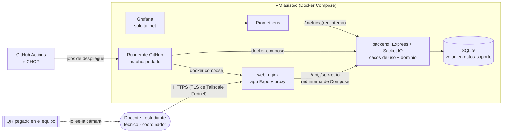

# Seguridad: modelo de amenazas, controles y registro de hallazgos

**Diseño y Arquitectura de Software (DYAS) · Corte 3**

Este documento trata la seguridad igual que el rendimiento: con un objetivo explícito y una verificación automática en el pipeline. Tiene cuatro partes:

1. [Modelo de amenazas (STRIDE)](#1-modelo-de-amenazas-stride) sobre el diagrama de contenedores.
2. [Controles del pipeline](#2-controles-del-pipeline-quality-gates): qué detecta cada uno, su umbral y qué lo detiene.
3. [Registro de hallazgos](#3-registro-de-hallazgos): cada hallazgo con su decisión (corregido, falso positivo o riesgo aceptado).
4. [Evidencia de que los controles funcionan](#4-evidencia-de-que-los-controles-funcionan): el pull request bloqueado.

Las herramientas, los umbrales y las alternativas descartadas se justifican en el [ADR-009](adr/ADR-009-seguridad-del-pipeline.md).

---

## 1. Modelo de amenazas (STRIDE)

### 1.1 Sobre qué se modela

El diagrama de contenedores del Corte 2 ([arquitectura.md §4.3](arquitectura.md#43-corte-2-diagrama-de-contenedores-c4-nivel-2)), con lo que el Corte 3 le agregó para desplegarlo ([vista de despliegue, arquitectura.md §8](arquitectura.md#8-vista-de-despliegue-corte-3)):

**Límites de confianza:** (1) Internet → nginx (lo único publicado); (2) nginx → backend (la API valida el JWT y el rol en cada ruta); (3) GitHub → runner del servidor (código del repositorio que se ejecuta en nuestra máquina); (4) el QR impreso, que cualquiera puede copiar o alterar.

### 1.2 Amenazas

Cada amenaza nombra un componente o flujo de AsisTec. La columna "Cómo se verifica" apunta a una prueba o a un control que corre en el pipeline; cuando la verificación no es automática se dice.

| # | Amenaza | STRIDE | Componente o flujo | Mitigación | Cómo se verifica |
|---|---|---|---|---|---|
| A1 | Alguien entra con la cuenta de un coordinador adivinando o reutilizando su clave, en especial las cuentas de demostración (`admin` / `admin123`) que se cargan en una base nueva | **S**uplantación | `POST /api/auth/login` → caso de uso `Autenticar` → tabla `usuarios` | **Autenticación:** claves con scrypt y sal aleatoria, comparación en tiempo constante (`timingSafeEqual`), sesión con JWT firmado que vence en 8 h. Consola de usuarios para crear el coordinador real, cambiar claves (mínimo 10 caracteres) y retirar las cuentas de demostración ([implementacion.md, paso 5.7](implementacion.md#57-primer-despliegue-primer-coordinador-y-cuentas-de-demostración)) | Integración `api.int.test.js` › "login con clave incorrecta responde 403"; `cliUsuarios.int.test.js` › "cambiar la clave de la cuenta de demostración admin: la clave conocida deja de servir"; unitarias `GestionarUsuarios.test.js` (clave de 9 caracteres rechazada, 10 aceptada). Riesgo residual sin límite de intentos: [R-01](#r-01-sin-límite-de-intentos-de-inicio-de-sesión) |
| A2 | Un atacante fabrica un JWT válido (por ejemplo con rol `ADMIN`) porque conoce el secreto de firma. En el Corte 2 `server.js` tenía un secreto de desarrollo por defecto | **S**uplantación / **E**levación | `CredencialesJWT` (adaptador del puerto `ServicioCredenciales`) | Sin valor por defecto: el backend no arranca sin `JWT_SECRET` y Compose se detiene con `${JWT_SECRET:?...}`. En el servidor el secreto viene de GitHub Environments y `scripts/escribir-env.sh` exige al menos 32 caracteres. Un secreto por entorno (pruebas y producción distintos) | El paso del CD "Escribir el .env del entorno" (`scripts/escribir-env.sh`) falla si falta el secreto o tiene menos de 32 caracteres; `docker compose config` falla sin `JWT_SECRET` (lo valida el job **Imágenes Docker y escaneo** con `.env.example`). Job **Secretos (Gitleaks)**: ningún secreto en el código ni en el historial. Además, `tiempoReal.int.test.js` › "una conexión sin token válido es rechazada" |
| A3 | Una docente o un estudiante llama directamente a `/api/admin/*` o `/api/tecnicos/yo/*` (sin usar la app) para asignar técnicos o cerrar solicitudes | **E**levación de privilegios | Adaptador HTTP (`app.js`) → `AsignarManualmente`, `AtenderSolicitud` | **Autorización por rol** en el adaptador de entrada (`soloRoles`) sobre el rol que viene dentro del JWT firmado; el cliente no puede cambiarlo | Integración `api.int.test.js` › "un docente no puede usar la pantalla del trabajador (403)", "un técnico no puede ver el panel administrativo (403)", "un técnico no puede crear solicitudes (403)". Playwright `e2e/pruebas/cuentas.spec.js` (cada cuenta recibe 403 en lo que no le toca) |
| A4 | Una docente ve las solicitudes de otra persona cambiando el número en `GET /api/solicitudes/:id`, o un cliente de Socket.IO escucha los eventos de otra sede | **D**ivulgación de información | `Consultas.estadoSolicitud`; `servidorSockets.js` (salas `usuario:X`, `sede:X`, `tecnico:Y`, `admin`) | El caso de uso solo muestra la solicitud a quien la creó, a los técnicos de su sede y al coordinador. El socket se autentica con el mismo JWT y entra solo a las salas que dicen sus datos firmados (el cliente no elige sala) | Integración `prototipo.int.test.js` › "cada cuenta ve solo el detalle de SUS solicitudes: la docente no abre el seguimiento de la estudiante (403)"; `tiempoReal.int.test.js` › "un técnico de otra sede NO recibe eventos del CAMPUS" y "una conexión sin token válido es rechazada" |
| A5 | Alguien imprime un QR alterado para crear solicitudes en otro salón o para un equipo que no existe ("mover" un equipo) | **M**anipulación (Tampering) | QR → `GET /api/qr/resolver` → `CodigoQR` → `CrearSolicitud` | El QR lleva solo `SOPORTE:v1:<código>`; el objeto de valor `CodigoQR` valida el formato y el servidor resuelve la ubicación desde la tabla `equipos`. El QR no puede decir dónde está el equipo | Integración `escaneoQR.int.test.js`: QR manipulado → 400, equipo inexistente → 404, QR de otro sistema rechazado; unitarias `CodigoQR.test.js` (clases de equivalencia y longitudes límite 4/5/40/41) |
| A6 | Una dependencia de npm o un paquete del sistema operativo con una vulnerabilidad conocida llega a producción en la imagen | **M**anipulación (cadena de suministro) | `package-lock.json` de backend y app; imágenes `asistec-backend` y `asistec-web` en GHCR | Jobs **SCA** (Trivy fs + dependency-review en los PR) e **Imágenes Docker y escaneo** (Trivy image), los dos con umbral alto o crítico con corrección. Imágenes base y herramientas con versión fija; Dependabot semanal; ruleset `proteger-main` exige los 8 checks | PR [#22](https://github.com/ItsN3M3515/soporte-tecnico-corte3/pull/22) bloqueado por SCA y por el escaneo de la imagen ([§4](#4-evidencia-de-que-los-controles-funcionan)) |
| A7 | Un pull request de un desconocido modifica un workflow para ejecutar comandos en el runner autohospedado (dentro de nuestro servidor) y robar los secretos o atacar la red de la casa | **E**levación / **M**anipulación | Runner `asistec-atlas` → VM `asistec` → Docker | Los jobs que usan el runner solo corren en `push` a `main`, tags `v*.*.*` o a mano: nunca en un `pull_request`. Los environments `pruebas` y `produccion` solo aceptan `main` y tags, así que un workflow de otra rama no recibe `JWT_SECRET`. Los PR de colaboradores externos necesitan aprobación para correr. La VM está en una red aislada que solo sale a Internet (no ve la red local ni el servidor que la aloja) | Revisión de la configuración: disparadores de `cd.yml`, reglas de rama de los environments (Settings → Environments), opción de aprobación para forks. No es una prueba automática; se declara así |
| A8 | Ráfaga de solicitudes o cuerpos enormes que dejan la cola de soporte sin responder en el inicio de clases | **D**enegación de servicio | `POST /api/solicitudes`, `GET /api/sedes/:sede/cola`, proceso único de Node | Cuerpo JSON limitado a 20 KB; la consulta de la cola acepta `limite` de 1 a 500 (ADR-004); el SLO se mide en cada despliegue; alertas de Prometheus si el p95 o los errores superan el SLO | Job **Prueba de carga del SLO**: p95 crear ≤ 500 ms, p95 cola ≤ 300 ms, errores < 1 %; integración `api.int.test.js` › "limite=0, 501, abc, 2.5 → 400". Riesgo residual: [R-02](#r-02-sin-limitación-de-peticiones-por-cliente) |
| A9 | Un técnico niega haber aceptado una solicitud, o nadie sabe quién desplegó la versión que falló | **R**epudio | Tabla `solicitudes` (`creada_por`, `tecnico_id`, marcas de tiempo); despliegues | Cada solicitud guarda quién la creó, qué técnico la tiene y cuándo cambió de estado (los cambios llegan por eventos a las pantallas). Cada despliegue queda en GitHub Actions (quién fusionó, qué PR, quién lo aprobó) y en `/opt/asistec/<entorno>/historial.log` del servidor | Sistema `flujoSistema.e2e.test.js` (la historia completa de una mañana, solo por HTTP: cada solicitud queda con su técnico y su estado); historial de Actions. Riesgo residual: la asignación manual no guarda qué coordinador la hizo ([R-04](#r-04-auditoría-parcial-de-acciones-del-coordinador)) |
| A10 | Tokens o claves quedan publicados en el repositorio o en los artefactos del pipeline | **D**ivulgación de información | Historial de Git, artefactos de Actions (resúmenes de k6), `.env` del servidor | Job **Secretos (Gitleaks)** revisa todo el historial. Los scripts de k6 quitan los JWT del resumen (`handleSummary` en `perf/scripts/slo.js`, `jq 'del(.setup_data)'` en `slo-larga.yml`). El `.env` del servidor se escribe con permisos 0600 | Job **Secretos (Gitleaks)** en cada push y PR; hallazgo [H-02](#3-registro-de-hallazgos) |
| A11 | Alguien de Internet lee las métricas internas o entra a Grafana | **D**ivulgación de información | `/metrics` del backend, Prometheus, Grafana | `/metrics` no pasa por nginx (solo `/api` y `/socket.io`), el puerto del backend escucha en 127.0.0.1 y Grafana solo se publica en la red privada del equipo (`tailscale serve`), nunca con Funnel. En Kubernetes una NetworkPolicy solo deja que los pods `web` lleguen al backend | Workflow **Kubernetes** › "La NetworkPolicy bloquea el acceso directo al backend" (un pod ajeno no llega). En Compose se revisa la configuración (`docker-compose.yml`) |

Autenticación (A1, A2) y autorización (A3, A4) aparecen entre las mitigaciones, como pide el enunciado para un sistema con usuarios.

---

## 2. Controles del pipeline (quality gates)

Los cuatro controles obligatorios corren en `ci.yml` en cada push y en cada pull request, cada uno como un check propio. Los cuatro son obligatorios en el ruleset `proteger-main`: si uno falla, el PR no se puede fusionar. En `main`, `cd.yml` vuelve a correr el CI completo antes de publicar la imagen.

| Control | Job (check en el PR) | Herramienta y versión | Umbral que detiene el pipeline | Comparado con el enunciado | Excepciones |
|---|---|---|---|---|---|
| SAST | **SAST (CodeQL)** | CodeQL `security-extended` + `scripts/umbral-sast.sh` | Algún hallazgo con `security-severity` ≥ 7,0 (alto o crítico) sin tratar | Igual umbral, **más reglas** (`security-extended` en lugar del conjunto por defecto) | `.github/codeql/excepciones-sast.txt` (hoy vacío) |
| SCA | **SCA (dependencias con Trivy)** | Trivy 0.76.2 `fs` + `actions/dependency-review-action` en los PR | Alguna vulnerabilidad alta o crítica con corrección en `backend/`, `app/` o `e2e/` | Igual | `.trivyignore` (H-01) |
| Secretos | **Secretos (Gitleaks)** | Gitleaks v8.30.1, reglas por defecto, todo el historial (`fetch-depth: 0`) | Cualquier secreto | Igual (cero, incluido el historial) | `.gitleaks.toml` (H-02, H-03, H-13) |
| Imagen | **Imágenes Docker y escaneo (Trivy)** | Trivy 0.76.2 `image` sobre `asistec-backend` y `asistec-web` | Alguna vulnerabilidad **alta** o crítica con corrección | **Más estricto**: el enunciado solo exige crítica | `.trivyignore` |
| DAST (bonificación) | **DAST (OWASP ZAP baseline)** en `cd.yml` | ZAP 2.17.0 contra el entorno de pruebas recién desplegado | Alguna regla marcada `FAIL` en `.zap/reglas.tsv` (cabeceras de seguridad, cookies, divulgación de errores y de versiones) | No exigido; se trata igual que los demás | `.zap/reglas.tsv` (las `WARN` se registran en H-09) |

**Herramientas que solo reportan.** CodeQL publica sus resultados en la pestaña Security pero nunca hace fallar el job. Por eso `scripts/umbral-sast.sh` lee el archivo SARIF, calcula la severidad de cada hallazgo y termina con error si alguno alto o crítico no está en la lista de excepciones. Además, el ruleset de `main` tiene la regla de code scanning de GitHub (alertas altas o más bloquean el merge). Dependabot abre PR de actualización (`.github/dependabot.yml`), pero no reemplaza el SCA: sus PR pasan por el mismo pipeline.

**Regla para las excepciones.** Un identificador solo entra a `.trivyignore`, `.gitleaks.toml`, `excepciones-sast.txt` o como `IGNORE` en `.zap/reglas.tsv` si tiene su fila en la sección 3 con la justificación. Una excepción sin registro cuenta como un control desactivado, y los umbrales se endurecen pero no se relajan.

**Cómo correr los controles en local** (necesitan Docker y Git Bash en Windows): `scripts/sca.sh`, `scripts/secretos.sh`, `scripts/escaneo-imagen.sh <imagen:tag>`. Son los mismos scripts del pipeline, con las mismas versiones.

---

## 3. Registro de hallazgos

Decisiones posibles: **Corregido** (con enlace al commit), **Falso positivo** (con la justificación técnica) o **Riesgo aceptado** (con la justificación y lo que haría falta para corregirlo). Los commits de corrección agruparon varios cambios; la columna dice qué parte del commit corrige el hallazgo.

| ID | Control | Hallazgo | Decisión | Justificación y detalle |
|---|---|---|---|---|
| H-01 | SCA (Trivy) y Dependabot | CVE-2026-118664 y CVE-2026-45822 en `decode-uri-component@0.2.2` (alta, denegación de servicio con una URL malformada). Alertas de Dependabot [#2](https://github.com/ItsN3M3515/soporte-tecnico-corte3/security/dependabot/2) y [#8](https://github.com/ItsN3M3515/soporte-tecnico-corte3/security/dependabot/8) | **Riesgo aceptado** | Llega por `expo-router → query-string@7`. La versión corregida (0.5.x) solo se publica como módulo ES y rompe el empaquetado de la app. Corre en el navegador del usuario, no en el servidor: el peor caso es que una URL maliciosa congele la pestaña de quien la abre; no afecta a otros usuarios ni a los datos. Todas las versiones 57.x de `expo-router` usan `query-string@7`; la única corrección es `expo-router` 58, que exige Expo SDK 58 (PR [#15](https://github.com/ItsN3M3515/soporte-tecnico-corte3/pull/15) de Dependabot, cerrado). **Para corregirlo:** migrar la app a SDK 58 (`npx expo install expo@58 --fix`), volver a correr la construcción, las pruebas de Playwright y la prueba de humo, y quitar las dos líneas de `.trivyignore`. Las alertas de Dependabot se descartaron como `tolerable_risk` con esta justificación |
| H-02 | Secretos (Gitleaks) | 42 JWT en `perf/resultados/*-resumen.json` (archivos del Corte 2) | **Falso positivo** | Los emitió un servidor local desechable durante las pruebas de carga del Corte 2, firmados con el secreto de desarrollo que ya se eliminó del código, y vencieron a las 8 horas: no dan acceso a nada. Se corrigió la causa para que no vuelva a pasar contra un entorno desplegado: `perf/scripts/slo.js` (`handleSummary`) y `slo-larga.yml` quitan los tokens del resumen. Excepción por ruta en `.gitleaks.toml` |
| H-03 | Secretos (Gitleaks) | Regla `generic-api-key` en `docs/evidencias/reporte-pruebas.html` | **Falso positivo** | Es JavaScript minificado de la librería dayjs dentro del reporte HTML de Jest (`Object.keys(e)...`); no hay ninguna llave. Excepción por ruta en `.gitleaks.toml` |
| H-04 | SCA | `body-parser` 1.20.8 (alta) en el backend | **Corregido** | Actualizado a 1.20.9 en el commit [da5a218](https://github.com/ItsN3M3515/soporte-tecnico-corte3/commit/da5a218) (cambio en `backend/package-lock.json`) |
| H-05 | SCA | `node-forge` (alta), `shell-quote` (crítica), `source-map-js` (alta) y `zod` (alta) en la app | **Corregido** | `node-forge`, `shell-quote` y `source-map-js` en el commit [0286d0f](https://github.com/ItsN3M3515/soporte-tecnico-corte3/commit/0286d0f); `zod` en el commit [9f81aa2](https://github.com/ItsN3M3515/soporte-tecnico-corte3/commit/9f81aa2) (PR #23, parches de Expo SDK 57). Cambios en `app/package-lock.json`; las alertas de Dependabot quedaron como `fixed` |
| H-06 | Imagen (Trivy) | Debian: `apt`, `pcre2`, `perl-base` (crítica) y librerías dentro de npm (`tar`, `sigstore`…) en la imagen del backend | **Corregido** | Commit [e5bd204](https://github.com/ItsN3M3515/soporte-tecnico-corte3/commit/e5bd204): `apt-get upgrade` en la imagen final y se borran npm, npx y corepack, que el contenedor no necesita porque arranca con `node` directo (`backend/Dockerfile`) |
| H-07 | Imagen (Trivy) | Alpine: `brotli` (crítica), `curl`, `libexpat` en la imagen web | **Corregido** | Commit [e5bd204](https://github.com/ItsN3M3515/soporte-tecnico-corte3/commit/e5bd204): `apk upgrade` y se quita `curl`; el healthcheck usa el `wget` de busybox (`app/Dockerfile`) |
| H-08 | DAST (ZAP, en local) | Falta `Strict-Transport-Security`; cabecera `X-Powered-By: Express` | **Corregido** | Commit [6b43ad1](https://github.com/ItsN3M3515/soporte-tecnico-corte3/commit/6b43ad1): HSTS en `app/docker/nginx.conf`, `app.disable('x-powered-by')` en el backend y `proxy_hide_header` en nginx. Desde entonces las dos reglas son `FAIL` en `.zap/reglas.tsv` |
| H-09a | DAST (ZAP en el pipeline, [run 42224537393](https://github.com/ItsN3M3515/soporte-tecnico-corte3/actions/runs/42224537393)) | 10038 *Content Security Policy (CSP) Header Not Set* | **Riesgo aceptado** | La app web es una exportación de Expo (react-native-web) que inyecta estilos en línea, usa la cámara (`getUserMedia`, `blob:`) y abre un WebSocket. Una CSP mal ajustada deja la app en blanco o sin cámara, y probarla bien exige recorrer todas las pantallas. Mientras tanto se mitiga lo principal: la app no muestra HTML que escriba el usuario (React escapa el texto), hay `X-Frame-Options: DENY`, `X-Content-Type-Options` y HSTS. **Para corregirlo:** agregar en `nginx.conf` una CSP como `default-src 'self'; style-src 'self' 'unsafe-inline'; img-src 'self' data: blob:; connect-src 'self' wss:; media-src 'self' blob:` y correr las pruebas de Playwright (`e2e/`) antes de fusionar |
| H-09b | DAST | 90004 *Insufficient Site Isolation Against Spectre* (falta COEP/COOP/CORP) | **Riesgo aceptado** | Estas cabeceras solo hacen falta para APIs como `SharedArrayBuffer`, que la app no usa, y `Cross-Origin-Embedder-Policy: require-corp` puede bloquear recursos. Bajo impacto. **Para corregirlo:** agregar `Cross-Origin-Opener-Policy: same-origin` y `Cross-Origin-Resource-Policy: same-origin` en nginx y verificar con las pruebas de Playwright |
| H-09c | DAST | 10015 *Re-examine Cache-control Directives* y 10049 *Storable and Cacheable Content* | **Falso positivo** (informativas) | ZAP baseline recorre la app estática sin iniciar sesión. Los archivos de `/_expo/` tienen un hash en el nombre y deben guardarse en caché (`expires 30d`); `index.html` no tiene datos de nadie. Las respuestas con datos personales son de la API, que exige `Authorization: Bearer` y que las cachés compartidas no guardan |
| H-09d | DAST | 90005 *Sec-Fetch-Dest Header is Missing* | **Falso positivo** (informativa) | Las cabeceras `Sec-Fetch-*` las envía el navegador, no el servidor; la alerta dice que el escáner no las mandó en su propia petición. No hay nada que corregir en AsisTec |
| H-09e | DAST | 10094 *Base64 Disclosure*, 10110 *Dangerous JS Functions*, 10096 *Timestamp Disclosure*, 10109 *Modern Web Application* | **Falso positivo** | Todas salen del JavaScript minificado del paquete de la app (cadenas en base64 de recursos, `eval` y funciones de librerías de terceros, números que parecen fechas). 10109 solo informa que es una aplicación de una sola página. Ninguna expone datos ni código del servidor |
| H-09f | DAST | 2 *Private IP Disclosure* | **Falso positivo** | Es el texto de ejemplo `192.168.1.20` del campo "Servidor" de la pantalla de inicio de sesión (`app/src/app/index.tsx`), que se usa en desarrollo con Expo Go. No es la dirección de ningún equipo de la infraestructura |
| H-10 | Dependabot ([#23](https://github.com/ItsN3M3515/soporte-tecnico-corte3/security/dependabot/23)) | `qs` 6.16.0 (media) en el backend | **Riesgo aceptado** (bajo el umbral; corrección en curso) | Severidad media: el umbral del SCA es alta o crítica, por eso no detiene el pipeline. La corrige el PR [#4](https://github.com/ItsN3M3515/soporte-tecnico-corte3/pull/4) de Dependabot (6.16.2), que pasó el pipeline y espera la aprobación de un integrante |
| H-11 | Dependabot ([#21](https://github.com/ItsN3M3515/soporte-tecnico-corte3/security/dependabot/21), [#26](https://github.com/ItsN3M3515/soporte-tecnico-corte3/security/dependabot/26), [#20](https://github.com/ItsN3M3515/soporte-tecnico-corte3/security/dependabot/20), [#25](https://github.com/ItsN3M3515/soporte-tecnico-corte3/security/dependabot/25)) | `minimatch` y `glob` (media) en app y backend | **Riesgo aceptado** (bajo el umbral) | Son dependencias de herramientas de desarrollo (Jest, ESLint, Expo CLI) que no entran a las imágenes: la del backend se construye con `npm ci --omit=dev` y la web solo lleva archivos estáticos. **Para corregirlo:** aplicar los PR agrupados de Dependabot (`backend-dev`, `app`) cuando las herramientas publiquen versiones compatibles |
| H-12 | Dependabot ([#24](https://github.com/ItsN3M3515/soporte-tecnico-corte3/security/dependabot/24)) | `deepmerge` (baja, sin corrección publicada) en el backend | **Riesgo aceptado** | Baja y sin versión corregida; es una dependencia de herramientas de desarrollo. Se revisa cuando exista una corrección |
| H-13 | Secretos (Gitleaks) | `generic-api-key` en `backend/tests/integration/cliUsuarios.int.test.js` del commit `fb01cc3` (rama `c3-41-documentacion-y-usuarios`, nunca fusionada) | **Falso positivo** | Era la constante `SECRETO` de la prueba de la consola de usuarios: el `JWT_SECRET` de una base SQLite temporal que la prueba crea y borra; no firma nada real. Lo detectó el control antes de abrir el PR. La prueba ahora genera el valor al azar (`crypto.randomBytes`) y la historia limpia está en la rama `c3-42-documentacion-corte3`; el commit viejo sigue en la rama abandonada, por eso la excepción es solo para ese commit (`.gitleaks.toml`). Al borrar esa rama, la excepción deja de hacer falta |

**Estado actual** (2026-11-07): code scanning sin alertas abiertas; SCA, secretos e imágenes en verde en el último commit de `main`; ninguna excepción sin registro.

### 3.1 Riesgos aceptados del diseño (no los detecta una herramienta)

#### R-01 Sin límite de intentos de inicio de sesión
`POST /api/auth/login` no bloquea después de varios intentos fallidos (amenaza A1). Lo mitiga que scrypt hace cada intento costoso y que las claves nuevas tienen al menos 10 caracteres. **Para corregirlo:** un limitador por IP y por usuario (por ejemplo `express-rate-limit` en el adaptador HTTP, o `limit_req` en nginx) con una prueba de integración que espere 429.

#### R-02 Sin limitación de peticiones por cliente
Un cliente autenticado puede crear solicitudes tan rápido como quiera (amenaza A8). La prueba de estrés del Corte 2 midió el quiebre en ≈140 solicitudes/s, muy por encima del uso real (2 sedes, 4 técnicos). **Para corregirlo:** igual que R-01, con un límite por usuario en `POST /api/solicitudes`.

#### R-03 Cuentas de demostración en una base nueva
El primer arranque carga datos de demostración, incluidas cuentas con claves conocidas (`admin` / `admin123`, ver README). En el entorno del proyecto se mantienen a propósito para que el profesor y los compañeros puedan probar la app. **Para corregirlo en una instalación real:** seguir [implementacion.md §5.7](implementacion.md#57-primer-despliegue-primer-coordinador-y-cuentas-de-demostración) (crear el coordinador real, retirar las cuentas de demostración y cambiar la clave de los técnicos).

#### R-04 Auditoría parcial de acciones del coordinador
La solicitud guarda el técnico, el estado y las marcas de tiempo, pero no qué coordinador la asignó a mano (amenaza A9). Con un solo coordinador por sede no es ambiguo. **Para corregirlo:** guardar el usuario del coordinador en `AsignarManualmente` y mostrarlo en el panel.

#### R-05 CORS abierto en la API y en Socket.IO
El backend responde a cualquier origen (`cors()` y `cors: { origin: '*' }`). No permite robar sesiones porque la sesión viaja en la cabecera `Authorization`, no en una cookie que el navegador mande solo. Hace falta para la app de Expo Go en desarrollo. **Para corregirlo:** limitar el origen a la URL pública con una variable de entorno.

---

## 4. Evidencia de que los controles funcionan

**Pull request bloqueado:** [#22 "[DEMO - NO FUSIONAR] Dependencia con vulnerabilidades conocidas (lodash 4.17.15)"](https://github.com/ItsN3M3515/soporte-tecnico-corte3/pull/22).

- **Qué introduce a propósito:** `lodash@4.17.15` en el backend, con CVE-2020-8203, CVE-2021-23337 y CVE-2026-4800 (altas, con corrección disponible).
- **Qué hizo el pipeline** ([run 42233222307](https://github.com/ItsN3M3515/soporte-tecnico-corte3/actions/runs/42233222307)): ❌ **SCA (dependencias con Trivy)** y ❌ **Imágenes Docker y escaneo (Trivy)**, porque la librería quedó dentro de `/app/node_modules` de la imagen del backend. Los demás checks pasaron, lo que muestra que el bloqueo se debe solo al control de seguridad.
- **Resultado:** GitHub marcó el PR como bloqueado por el ruleset `proteger-main` (checks obligatorios en rojo) y se cerró sin fusionar el 2026-11-06. La rama `demo-pr-bloqueado-dependencia-vulnerable` se conserva para que se vea el cambio.

**Otras evidencias:** el primer CD completo ([run 42224537393](https://github.com/ItsN3M3515/soporte-tecnico-corte3/actions/runs/42224537393)) muestra los cuatro controles y ZAP en verde sobre lo desplegado; la pestaña [Security](https://github.com/ItsN3M3515/soporte-tecnico-corte3/security) muestra code scanning sin alertas y las alertas de Dependabot con su estado.
